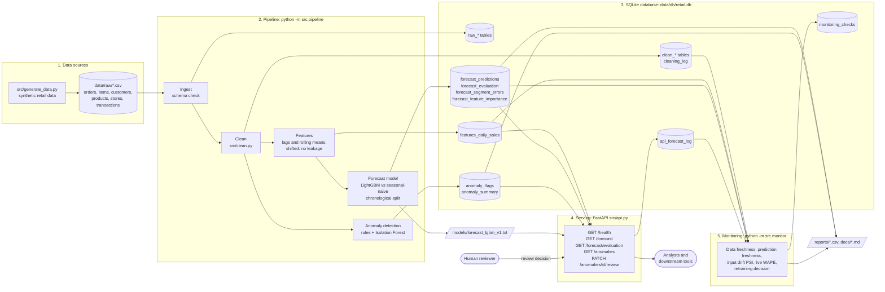

# Architecture

## System overview

## Components

| Layer | Files | Role |
|---|---|---|
| Data | `src/generate_data.py`, `data/raw/` | Creates the six source CSV files |
| Pipeline | `src/pipeline.py`, `src/clean.py`, `src/metrics.py` | Rebuilds every table and the model with one command |
| Storage | `data/db/retail.db`, `reports/`, `models/` | SQL tables for downstream tools, CSV copies, saved model |
| Serving | `src/api.py` | Validated endpoints; every prediction carries a timestamp and model version |
| Monitoring | `src/monitor.py`, `docs/monitoring.md` | Freshness, drift, live performance, retraining rules |
| Exploration | `notebooks/Step1-Step8` | Where each stage was explored and explained; also produce the EDA and SHAP reports |
| Quality | `tests/` | 26 tests: API routes, cleaning, features (leakage), metrics |

## Data flow in words

1. Raw CSV files are loaded unchanged into `raw_*` tables with their source file and load time.
2. Cleaning fixes duplicates, bad dates, impossible quantities and inconsistent categories, and logs every change.
3. Features are built per store per day, using only information available 7 days earlier.
4. The forecast model is trained on 2024-07-01 to 2025-08-31 and tested on 2025-09-01 to 2025-12-31.
5. Anomaly rules and an Isolation Forest flag unusual transactions, each with a reason and a review status.
6. The API serves forecasts and flags and accepts reviewers' decisions, which survive pipeline re-runs.
7. The monitor reads the tables and the API forecast log and recommends when to retrain.